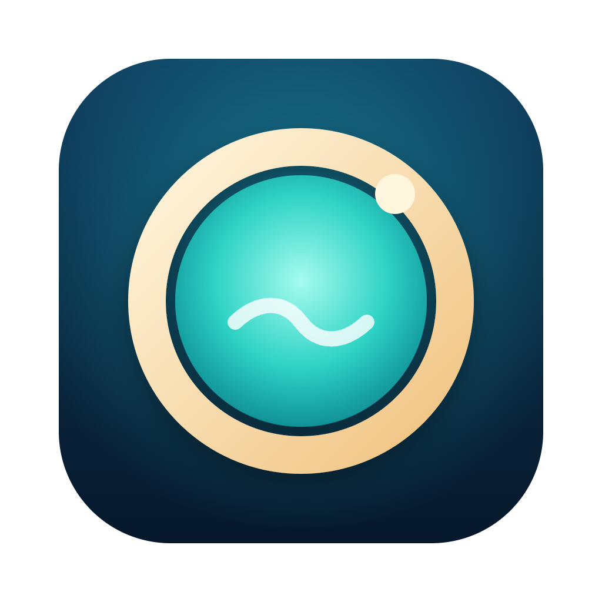
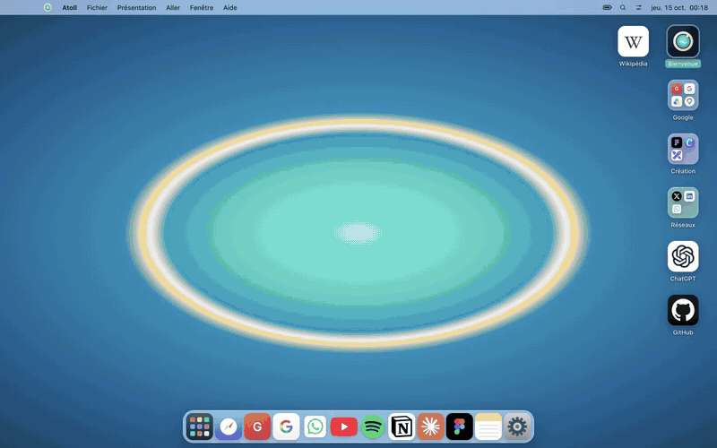
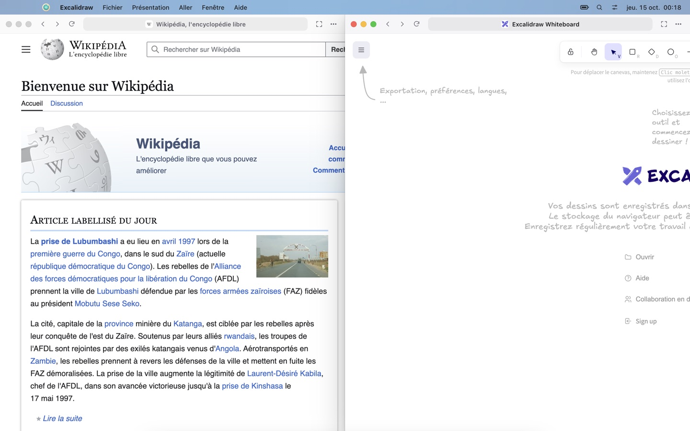
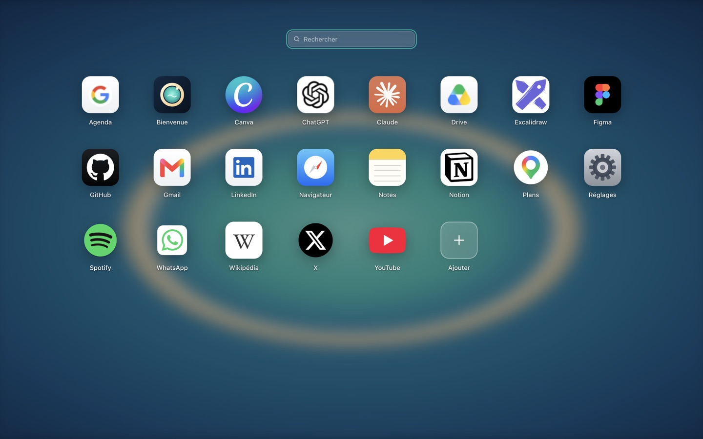
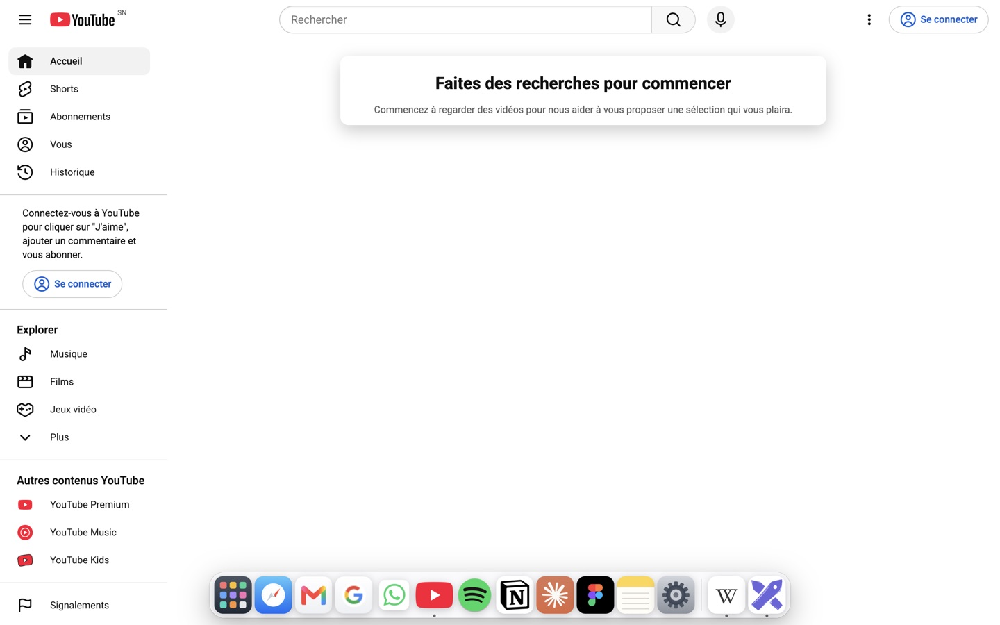
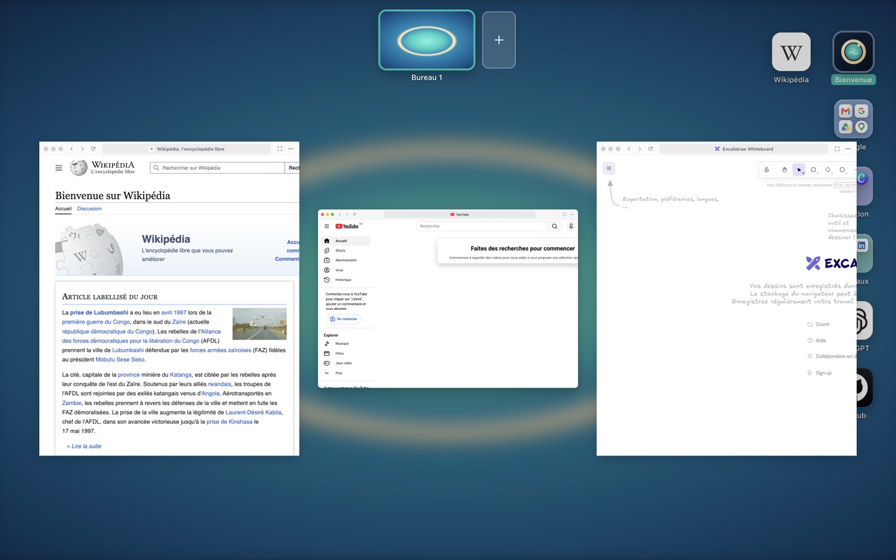
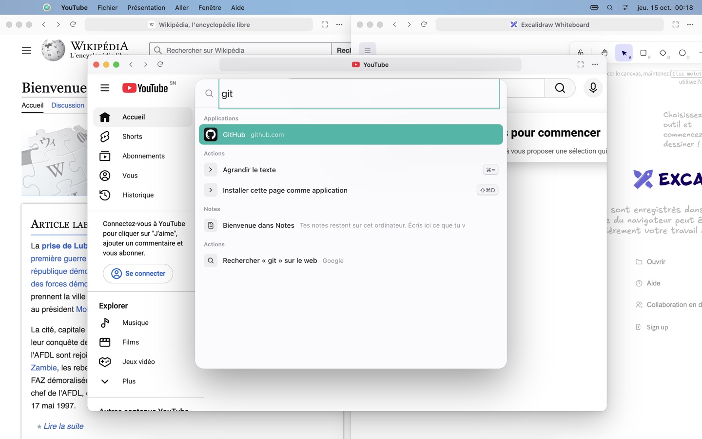
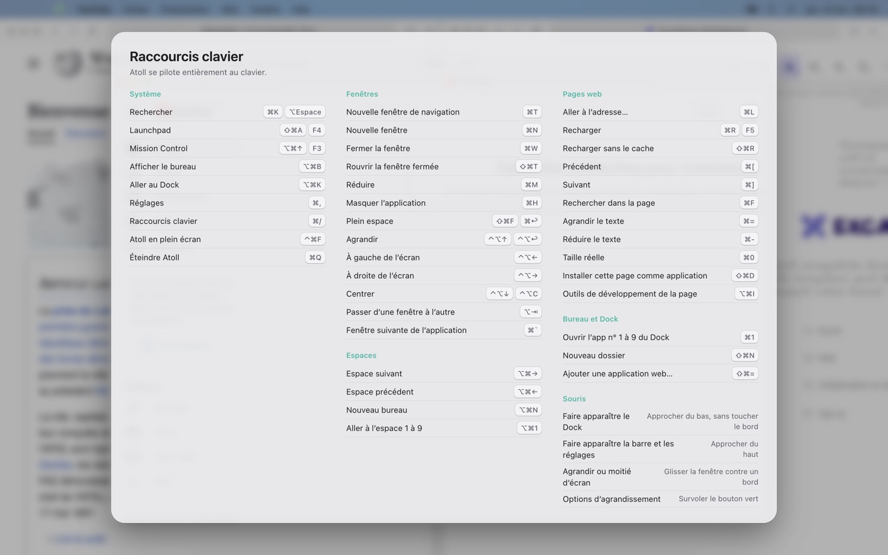

<div align="center">



# Atoll

### The browser that boots like an operating system.

Your web apps become real windows — with a desktop, a Dock, folders, spaces, Mission Control and a keyboard shortcut for everything.<br>
Built on Chromium. Free and open source.

[**Download for Mac (Apple Silicon)**](https://github.com/amadoubaui/atoll/releases/latest/download/Atoll-mac-apple-silicon.zip) · [Mac Intel](https://github.com/amadoubaui/atoll/releases/latest/download/Atoll-mac-intel.zip) · [Windows](https://github.com/amadoubaui/atoll/releases/latest/download/Atoll-windows-x64.zip) · [Website](https://atoll.pixework.pro) · [Version française](README.fr.md)



</div>

---

## Why?

We live in the browser. Gmail, Figma, Notion, WhatsApp, YouTube, Claude, ChatGPT — that *is* our computer now. Yet browsers still squeeze everything into a row of tabs.

**Atoll flips it around.** Click it and it takes over the whole screen, like switching on a Mac. Every site is an app with its own window. You drag windows around, snap them side by side, minimize them into the Dock, give one a whole space to itself, and fly through it all with the keyboard.

It's the desktop you already know — except every app is a website, and nothing needs installing.

## What it does

| | |
|---|---|
| 🖥️ **Boots full screen** | Atoll opens like a system you just turned on: boot screen, desktop, Dock, menu bar. Leave full screen any time and resize it like a normal window. |
| 🪟 **Real windows** | Move, resize, minimize into the Dock (genie-style), zoom, snap to halves and quarters by dragging against an edge — or with the keyboard. |
| 🌊 **Full space** | The green button gives a window its own space: edge to edge, no border, no bar. Like macOS full screen, for any website. |
| ⚓ **The Dock that knows its place** | Move the pointer *near* the bottom — not all the way — and Atoll's Dock rises. Go all the way down and it steps aside so it never overlaps the macOS Dock. Same idea at the top for the menu bar and Control Center. |
| 🗂️ **Desktop & folders** | Icons on the desktop, folders you drag apps into, right-click menus, rename, tidy up. Your desktop, your way. |
| 🚀 **Launchpad & Spotlight-style search** | All your apps in a grid. Search apps, open windows, notes, commands, or type a URL. |
| 🧭 **Spaces & Mission Control** | Several desktops, and every window at a glance. |
| ⌨️ **Keyboard first** | More than 60 shortcuts. Press <kbd>⌘</kbd><kbd>/</kbd> to see them all. Every action in Atoll can be done without the mouse. |
| ➕ **Any site becomes an app** | Add a URL, or install the page you're on (<kbd>⌘</kbd><kbd>⇧</kbd><kbd>D</kbd>). Atoll fetches its best icon. |
| 🎛️ **Control Center** | Light/dark theme, Do Not Disturb, mute all apps, Dock size, wallpapers. |
| 🔒 **Private by design** | No telemetry, no account, no server. Your desktop, notes and settings stay on your computer. Web pages are sandboxed and can't reach anything but the web. |

<table>
<tr>
<td><br><sub>Snap two apps side by side — <kbd>⌃⌥←</kbd> <kbd>⌃⌥→</kbd></sub></td>
<td><br><sub>Launchpad — <kbd>⌘⇧A</kbd></sub></td>
</tr>
<tr>
<td><br><sub>Full space: the Dock rises when you approach the bottom — <kbd>⌘⇧F</kbd></sub></td>
<td><br><sub>Mission Control — <kbd>⌘⌥↑</kbd></sub></td>
</tr>
<tr>
<td><br><sub>Search everything — <kbd>⌘K</kbd></sub></td>
<td><br><sub>Every shortcut — <kbd>⌘/</kbd></sub></td>
</tr>
</table>

## Keyboard shortcuts (the essentials)

On Windows, <kbd>⌘</kbd> is <kbd>Ctrl</kbd>.

| Action | Shortcut |
|---|---|
| Search apps, windows, URLs | <kbd>⌘K</kbd> or <kbd>⌥Space</kbd> |
| Launchpad | <kbd>⌘⇧A</kbd> |
| Mission Control | <kbd>⌘⌥↑</kbd> |
| Full space on / off | <kbd>⌘⇧F</kbd> |
| Switch windows | <kbd>⌥Tab</kbd> |
| Next / previous space | <kbd>⌘⌥→</kbd> / <kbd>⌘⌥←</kbd> |
| Snap left / right / zoom | <kbd>⌃⌥←</kbd> / <kbd>⌃⌥→</kbd> / <kbd>⌃⌥↑</kbd> |
| Open Dock app 1–9 | <kbd>⌘1</kbd> … <kbd>⌘9</kbd> |
| New browser window | <kbd>⌘T</kbd> |
| Close / reopen window | <kbd>⌘W</kbd> / <kbd>⌘⇧T</kbd> |
| Show desktop | <kbd>⌘⌥B</kbd> |
| All shortcuts | <kbd>⌘/</kbd> |

## Install

**macOS**: download [`Atoll-mac-apple-silicon.zip`](https://github.com/amadoubaui/atoll/releases/latest/download/Atoll-mac-apple-silicon.zip) (M1, M2, M3, M4…) or [`Atoll-mac-intel.zip`](https://github.com/amadoubaui/atoll/releases/latest/download/Atoll-mac-intel.zip), unzip, drag **Atoll** into *Applications*.
Atoll isn't notarized by Apple yet (that costs money), so the first time: right-click Atoll → **Open** → **Open**. Or in Terminal: `xattr -cr /Applications/Atoll.app`.

**Windows** 10/11: download [`Atoll-windows-x64.zip`](https://github.com/amadoubaui/atoll/releases/latest/download/Atoll-windows-x64.zip), unzip, run `Atoll.exe`. If SmartScreen appears: *More info* → *Run anyway*.

## Under the hood

- **Chromium engine**, through Electron. No fork to maintain: every Chromium security update lands fast.
- **Stripped down**: no tabs strip, no omnibox chrome, no sync, no telemetry, no extensions store. Electron's risky fuses (RunAsNode, NODE_OPTIONS, inspector) are burned out of the binary.
- **Every web app is a sandboxed `<webview>`** composited inside the shell. That's what lets the Dock float over a page, windows animate into the Dock, and Mission Control show live windows.
- **Keyboard shortcuts are caught in the browser process**, before any page sees them — so <kbd>⌘K</kbd> works even while you're typing in Gmail.
- **Vanilla JavaScript**, no framework, no bundler. The whole shell is a few thousand readable lines in [`src/renderer`](src/renderer).

```sh
git clone https://github.com/amadoubaui/atoll && cd atoll
node scripts/dev.js          # run (downloads Electron once into ~/.atoll-dev)
node scripts/test-ui.js      # end-to-end tests, driven like a real user
node scripts/build-mac.js    # build Atoll.app
```

## Roadmap

- [ ] Tabs inside a window, for those who want them
- [ ] Widgets on the desktop (clock, weather, notes)
- [ ] Drag a window to another space in Mission Control
- [ ] Per-app profiles (two Gmail accounts side by side)
- [ ] Built-in ad blocker
- [ ] Linux build

Ideas welcome — [open an issue](https://github.com/amadoubaui/atoll/issues).

## Contributing

Pull requests are welcome. Run `node scripts/test-ui.js` before sending one: it launches Atoll and drives it with the mouse and keyboard (18 scenarios).

## Also by the same author

- [**Orbe**](https://github.com/amadoubaui/orbe) — a free, open-source browser in the spirit of Arc, with a sidebar, Spaces and Boosts.
- [**KoraCut**](https://github.com/amadoubaui/koracut) — a free multimedia studio (editing, color grading, audio, motion design) that AI agents can drive.

## Support

Atoll is free and always will be. If you like it, a ⭐ on GitHub helps a lot — and you can [buy me a coffee](https://buymeacoffee.com/amadouba).

<div align="center"><sub>Made by <a href="https://pixework.pro">Amadou Ba — PIXEWORK</a> · MIT License</sub></div>
